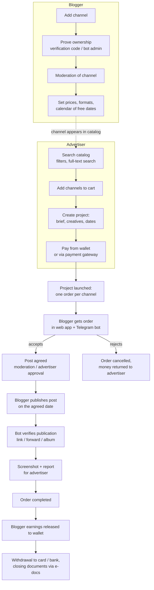
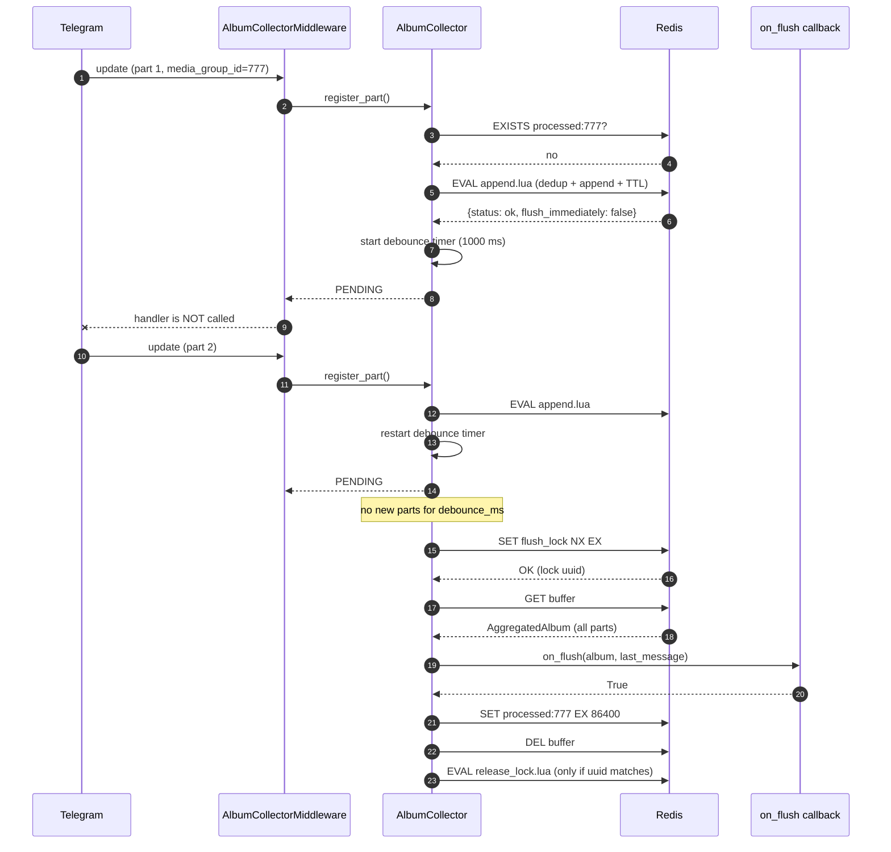

# Advertiser ↔ Blogger Marketplace: Backend

A backend for a marketplace where **advertisers** buy ad placements in **bloggers'** channels (mainly Telegram, with Instagram and YouTube support), and the platform handles everything in between: catalog, ordering, payments, publication control, documents and payouts.

> This repository is a **showcase**. The product is commercial and closed-source; only one self-contained module, the [Album Collector](#showcase-module-album-collector), is published here together with its tests. The sections below describe the whole system so the module can be seen in context. See [LICENSE](LICENSE).

---

## Table of contents

- [About the product](#about-the-product)
  - [Roles](#roles)
  - [Main flow](#main-flow)
  - [Order lifecycle](#order-lifecycle)
  - [Post verification in the Telegram bot](#post-verification-in-the-telegram-bot)
  - [Money flow](#money-flow)
  - [Other features](#other-features)
- [Architecture](#architecture)
  - [Runtime components](#runtime-components)
  - [Layers](#layers)
  - [Request flow](#request-flow)
  - [Tech stack](#tech-stack)
  - [Scale](#scale)
- [Showcase module: Album Collector](#showcase-module-album-collector)

---

## About the product

Buying ads from bloggers usually means manual work: finding channels, negotiating prices and dates in DMs, paying upfront with no guarantee, chasing the blogger to publish, and checking by hand that the post went out with the right text. The platform turns this into one managed process with escrow-style payments and automatic control of publication.

### Roles

| Role | What they do |
|------|--------------|
| **Advertiser** | Searches the channel catalog, builds a campaign (project), pays, approves posts, receives reports. |
| **Blogger** (channel owner) | Adds and verifies their channels, sets prices and available dates, accepts orders, publishes posts, gets paid. |
| **Agency / manager** | Runs campaigns on behalf of clients: builds projects, coordinates bloggers, gets aggregated reports. |
| **Moderator** | Approves channels and posts, handles complaints and disputes. |
| **Superuser** | Platform administration, finance operations, reference data. |

Users can act as a legal entity, an individual entrepreneur or an individual. Their legal data is validated against the national tax service.

### Main flow



### Order lifecycle

A **project** is the advertiser's campaign. When it is launched, it is split into **orders**: one order per channel. Each order has its own status, date, post and chat, so one blogger's delay never blocks the others.

The main path of an order, simplified:

```
 wait ──► in_progress ──► post_review / moderation ──► advertiser_coordination ──► completed
   │            │                    │                            │
   └────────────┴──── rejected / canceled (money is returned) ────┘
                         frozen (paused by the platform, can be resumed)
```

Every transition is a separate use case (`order_blogger_accept`, `order_blogger_reject`, `moderation_order_accept`, `advertiser_order_accept`, `publish_post`, ...). Each one changes the order, the paired project state and, where needed, the wallet in one place, so the state of money always follows the state of the order.

Reminders are sent to bloggers before the publication time, and late or missed publications are handled automatically.

### Post verification in the Telegram bot

This is the part of the system the published module belongs to.

1. After publishing, the blogger sends the post to the bot: a **link** (`t.me/channel/123`), a **forward** of the post, or the post as an **album**.
2. The bot extracts the channel and the post from the message (forward metadata or the URL).
3. The backend finds the blogger's orders for that channel for today.
4. The text of the published post is compared with the brief (fuzzy matching, so small formatting differences do not fail the check).
5. On a match, the publication is recorded, a screenshot is taken, and the advertiser sees the result in the report.

Albums need special handling because Telegram delivers them as several separate updates. That is what the [Album Collector](#showcase-module-album-collector) solves.

The bot also lets users create projects from Telegram, receive and accept orders, and get notifications.

### Money flow

- Every user has an internal **wallet**. Advertisers top it up through online payment gateways or by bank transfer with an invoice.
- When a project is paid, the money is **held** on the platform, not sent to the blogger right away.
- When an order is completed, the blogger's part is released to their wallet. When an order is cancelled or rejected, the advertiser gets the money back.
- Bloggers withdraw earnings to a card or bank account; withdrawals go through approval.
- Platform commission, VAT and promo code discounts are calculated in the domain layer and stored as separate lines, so every amount on an invoice can be traced.
- Contracts, invoices and acts are signed through an **electronic document** service, with status updates coming back by webhook.

### Other features

- **Catalog and search**: full-text channel search with filters, categories and channel statistics collected from social networks.
- **Channel calendar**: bloggers mark busy days and limits; the platform does not sell dates that are taken.
- **Chats**: real-time chats per order and per project between the advertiser, the blogger and support.
- **Notifications**: in-app (real-time), email and Telegram.
- **Promo codes** for carts and projects.
- **Reports**: PDF and Excel reports for advertisers and agencies, screenshots of published posts.
- **AI helpers**: generating post text and images for a brief.
- **Admin panel API**: moderation queues, order management, finance operations, bulk import of channels from spreadsheets.

---

## Architecture

### Runtime components

```
                    ┌───────────────────────────── backend ──────────────────────────────┐
 Web app ──────────►│                                                                     │
 Admin panel ──────►│  FastAPI REST API  (/api/v1)                                        │
                    │                                                                     │
 Telegram ─webhook─►│  aiogram 3 bot  ──► AlbumCollectorMiddleware ──► handlers           │
 Payment / e-docs ─►│  webhook endpoints                                                  │
                    │            │                                                        │
                    │            ▼                                                        │
                    │  application layer: use cases with input / output DTOs             │
                    │            ▲                                                        │
                    │  FastStream worker (NATS): events, background jobs, reports        │
                    └──┬──────────┬──────────┬───────────┬───────────┬───────────────────┘
                       │          │          │           │           │
                 PostgreSQL     Redis    Manticore   Centrifugo   S3 storage
                 (write/read)  (cache,   (full-text  (real-time   (media, reports,
                               bot state, search)    chats and    screenshots)
                               locks)                notifications)
```

- **Web service.** FastAPI under gunicorn with several workers. The Telegram bot runs **in webhook mode inside the same app**, so bot updates are served by the same workers as HTTP requests.
- **Worker.** A separate process on FastStream + NATS. Use cases publish events (order changed, channel added, report requested...), and consumers grouped by domain (order, project, channel, chat, notification, report, search) handle them asynchronously. A transactional outbox keeps events consistent with database writes.
- **PostgreSQL** with separate write and read connections. Migrations with Alembic.
- **Redis** for cache, bot FSM state, and short-lived coordination data such as album buffers and locks.
- **Manticore Search** for catalog search, **Centrifugo** for real-time delivery, **S3** for files.

### Layers

The code follows **Clean Architecture** with a **CQRS-style split** of the application layer:

```
presentation   FastAPI routes, request/response models, bot handlers, middlewares
     │
application    use cases:  record/  (commands, change state)
     │                     read/    (queries, return read models)
     │                     events/  (event handlers)
     │         each use case = dto.py + interface.py + use_case.py
     │
domain         entities, value objects, domain services (wallet, order, organization ...)
     ▲
infrastructure SQLAlchemy models and repositories, payment gateways, e-docs, search,
               real-time, S3, email, social network clients, DI providers
```

Rules:
- the domain has no dependencies on frameworks;
- a use case depends only on interfaces (`Protocol`) that it declares itself, and returns DTOs, never ORM objects or domain entities;
- infrastructure implements those interfaces;
- everything is wired with **Dishka**, and the same use case is called from an HTTP route, a bot handler or a broker consumer.

### Request flow

1. A request reaches a FastAPI route (or a bot handler, or a broker consumer).
2. The input is validated by a Pydantic model and converted into the use case input DTO.
3. The use case is resolved from the DI container and called.
4. The use case applies business rules through domain services and talks to the outside world only through its interfaces.
5. Repositories run the SQL and return data.
6. The use case returns an output DTO, and the route turns it into the HTTP response.

### Tech stack

| Area | Technology |
|------|------------|
| Language | Python 3.10, asyncio |
| HTTP API | FastAPI, Pydantic, gunicorn / uvicorn |
| Telegram | aiogram 3 (webhook) |
| DI | Dishka |
| Database | PostgreSQL, SQLAlchemy 2.0 async, asyncpg, Alembic |
| Messaging | NATS, FastStream |
| Cache / coordination | Redis |
| Search | Manticore Search |
| Real-time | Centrifugo |
| Storage | S3-compatible object storage |
| Auth | JWT, Google OAuth2 |
| Integrations | payment gateways, electronic documents, tax service, email, social network APIs, OpenAI |
| Observability | structlog, Prometheus, Sentry |
| Delivery | Docker, GitHub Actions, Kubernetes |
| Tests | pytest, pytest-asyncio, fakeredis |

### Scale

About **100,000 lines** of application code in ~1,800 files: several hundred use cases, ~50 database migrations, dozens of HTTP routers, and three deployable processes (web, worker, bot) built from one codebase.

---

## Showcase module: Album Collector

An [aiogram 3](https://docs.aiogram.dev/) middleware that turns a Telegram **media group** (an album of several photos / videos / documents) into **one** event, safely, across multiple backend workers. It is used in the [post verification](#post-verification-in-the-telegram-bot) flow.

Because the bot lives inside a web service that runs as several workers, the updates of one album can be handled by different processes. This is why the collector keeps its state in Redis and not in process memory.

### The problem

Telegram does not deliver an album as one message. It delivers **N separate updates** that share a `media_group_id`:

```
update 1001  message 501  photo  media_group_id=777  caption="Ad text..."
update 1002  message 502  photo  media_group_id=777
update 1003  message 503  video  media_group_id=777
```

This causes four problems:

1. **Duplicate processing.** A regular handler fires once per part, so verification (and every side effect behind it) runs N times.
2. **The caption is on one part only**, and it is not always the first part to arrive. Updates can come out of order.
3. **Forward metadata is per part.** Each forwarded part carries its own `forward_origin`. You cannot just take "the last message" and trust it as the album source.
4. **Horizontal scaling.** The webhook is served by several backend workers, so the parts of one album can land on different processes. An in-memory buffer cannot see the whole album.

There is also no "album finished" signal from Telegram. The only option is to wait for a quiet period.

### How it works

The idea: intercept album parts **before** any handler sees them, accumulate them in Redis, and when the album has stopped growing, hand the complete album to a single callback exactly once.

#### Components

| Component | Responsibility |
|-----------|----------------|
| `AlbumCollectorMiddleware` | Outer middleware on `Dispatcher.message`. Lets normal messages through, routes album parts to the collector and stops them from reaching handlers. |
| `AlbumCollector` | Converts `Message` → `AlbumPart`, runs the debounce timer, performs the flush and calls `on_flush`. |
| `AlbumBufferStore` (protocol) | Storage contract: append, get, delete, lock, processed marker. |
| `RedisAlbumBufferStore` | Production storage. Atomic append and safe lock release through Lua scripts. |
| `InMemoryAlbumBufferStore` | Same contract in memory, used in tests. |
| `forward_message` | Extracts forward source (channel id, username, message id, post URL) from a message or a stored part. |
| `post_submission` | Builds the final `PostSubmissionInput` from an aggregated album. |

#### End-to-end flow



#### Step by step

**1. Middleware filter.**
The middleware checks the incoming event. If it is not a `Message`, or `media_group_id` is `None`, it calls the next handler as usual. Single messages, commands and links are not affected at all.

**2. Pre-checks in `register_part`.**
The part is ignored if:
- the message has no sender (`from_user is None`);
- the album is already marked as processed in Redis (a late or re-delivered update);
- the part has no supported media (photo / video / document).

**3. Normalization.**
The `Message` is converted into an immutable `AlbumPart`. It keeps only what is needed later: ids, `file_id`, media type, caption, date and forward metadata. For photos the largest size is taken. This makes the part serializable and independent of aiogram objects.

**4. Atomic append (Lua).**
A single Lua script runs inside Redis:
1. reads the buffer, or creates it from a skeleton;
2. returns `duplicate` if a part with the same `message_id` is already there;
3. appends the part, updates `updated_at` and resets the TTL;
4. returns `flush_immediately = true` if the album reached `max_items` (Telegram's album limit is 10).

Because it is one script, concurrent appends from different workers cannot overwrite each other. A plain `GET` → modify → `SET` would lose parts.

**5. Debounce.**
For each `(chat_id, media_group_id)` the collector keeps one `asyncio.Task` that sleeps for `debounce_ms`. Every new part cancels the previous timer and starts a new one. So the flush happens `debounce_ms` after the **last** part. If `max_items` is reached, the timer is cancelled and the flush starts immediately.

**6. Flush under a distributed lock.**
The flush starts with `SET flush_lock <uuid> NX EX flush_lock_ttl_sec`.
- If the lock is taken, someone else is flushing this album, so the call just returns.
- The buffer is read. If it has expired, a warning is logged and the flush stops.
- `on_flush(aggregated, last_message)` is called. `last_message` is passed so the callback can reply to the user.

**7. Commit or keep.**
- `on_flush` returned `True`: the album is marked `processed` (24 h by default) and the buffer is deleted.
- `on_flush` returned `False` or raised: nothing is committed. The buffer remains until its TTL expires.

**8. Safe lock release.**
In `finally`, the lock is released by a Lua script that deletes the key **only if it still holds our uuid**. If the lock had expired and another worker took it, we will not delete someone else's lock.

#### Redis data layout

| Key | Value | TTL | Purpose |
|-----|-------|-----|---------|
| `telegram:album:{chat_id}:{media_group_id}` | JSON `AggregatedAlbum` | `buffer_ttl_sec`, refreshed on each append | parts buffer |
| `telegram:album:flush_lock:{chat_id}:{media_group_id}` | lock owner uuid | `flush_lock_ttl_sec` | one flush at a time |
| `telegram:album:processed:{chat_id}:{media_group_id}` | `"1"` | `processed_ttl_sec` | idempotency marker |

Every key has a TTL, so a crashed worker never leaves garbage in Redis forever.

#### Register results

`register_part` returns a `RegisterResult`, and the middleware acts on it:

| Result | Meaning | Middleware |
|--------|---------|------------|
| `PENDING` | part stored, debounce timer (re)started | stop, no handler |
| `FLUSH_SCHEDULED` | `max_items` reached, flush started | stop, no handler |
| `DUPLICATE` | same `message_id` already in the buffer | stop, no handler |
| `IGNORED` | already processed / no media / no sender | log a warning, stop |

#### Forwarded albums

When a user forwards an album from a channel, each part has its own forward metadata. `AlbumPart` stores it explicitly (`forward_chat_id`, `forward_chat_username`, `forward_message_id`, `forward_date`), so it survives the round trip through Redis.

When building the result, `AggregatedAlbum` gives deterministic answers regardless of arrival order:

- `caption`: the first non-empty caption, by `message_id`;
- `primary_message_id`: the part with the caption, or the smallest `message_id`;
- `forward_part`: the first forwarded part, by `message_id`.

`extract_post_submission_from_album` then builds a `PostSubmissionInput`:

- **forwarded album**: channel id / username and the post URL (`https://t.me/<username>/<id>` or `https://t.me/c/<id>/<msg>` for private channels) come from the forward source; the caption becomes the post text;
- **album with a link in the caption**: channel and post are parsed from the URL; if the caption is *only* a link, the text is `None`;
- in both cases, the media list is sorted by `message_id`.

Both the legacy `forward_from_chat` fields and the newer `forward_origin` API are supported.

### Guarantees

| Property | How |
|----------|-----|
| No lost parts under concurrency | append + dedup in one Lua script |
| One flush per album | `SET NX` lock with owner uuid |
| No reprocessing of re-delivered updates | `processed` marker checked before append |
| At-least-once handling | the marker is set only after `on_flush` returns `True` |
| No foreign lock release | compare-and-delete Lua script |
| Bounded memory | TTL on every key; timers and `last_message` are removed on flush |
| Order independence | results are derived from parts sorted by `message_id` |

### Edge cases

| Situation | Behaviour |
|-----------|-----------|
| Parts arrive out of order | stored as they come, sorted at read time |
| Same update delivered twice | `DUPLICATE`, ignored |
| Late part after a successful flush | `IGNORED` (album already processed) |
| Album bigger than `max_items` | flushed as soon as the limit is reached |
| Two workers flush simultaneously | one gets the lock, the other returns |
| Callback fails | not marked processed; logged |
| Buffer expired before flush | logged, nothing is called |
| Text-only message or command | not touched by the middleware |

### Configuration

```python
@define
class AlbumCollectorConfig:
    enabled: bool = True
    debounce_ms: int = 1000          # quiet period before flush
    buffer_ttl_sec: int = 30         # buffer lifetime, refreshed on every part
    max_items: int = 10              # flush immediately at this size
    flush_lock_ttl_sec: int = 30     # must be longer than on_flush runtime
    processed_ttl_sec: int = 86400   # how long re-deliveries are ignored
```

How to choose the values:
- `debounce_ms` is a trade-off between latency and completeness. About 1 s is enough for Telegram to deliver all parts in practice.
- `buffer_ttl_sec` must be noticeably larger than `debounce_ms`.
- `flush_lock_ttl_sec` must cover the worst-case duration of `on_flush`.

### Usage

```python
from aiogram import Bot, Dispatcher
from aiogram.types import Message
from redis.asyncio import Redis

from album_collector.collector import AlbumCollector
from album_collector.config import AlbumCollectorConfig
from album_collector.middleware import AlbumCollectorMiddleware
from album_collector.models import AggregatedAlbum
from album_collector.post_submission import extract_post_submission_from_album
from album_collector.redis_store import RedisAlbumBufferStore


async def handle_album(album: AggregatedAlbum, last_message: Message) -> bool:
    submission = extract_post_submission_from_album(aggregated=album)
    await last_message.answer(
        f"Got an album of {len(submission.media)} items, post: {submission.post_url or '-'}"
    )
    return True  # True = processed, do not handle again


config = AlbumCollectorConfig()
store = RedisAlbumBufferStore(redis=Redis.from_url("redis://localhost:6379"), config=config)
collector = AlbumCollector(store=store, config=config, on_flush=handle_album)

dp = Dispatcher()
dp.message.outer_middleware(AlbumCollectorMiddleware(collector))
```

Return `False` from the callback (or raise) when the album could not be handled. It will not be marked as processed.

### Testing

```bash
pip install -r requirements-dev.txt
pytest
```

Redis is emulated with `fakeredis[lua]`, so no server is needed and the real Lua scripts run in tests.

What is covered (18 tests):

- debounce flushes all parts exactly once;
- `max_items` triggers an immediate flush;
- duplicate `message_id` is rejected;
- processed albums are ignored;
- commit only on success: `True` commits, `False` and exceptions do not;
- concurrent appends do not lose parts;
- a second lock attempt fails while the first one holds the lock;
- a worker cannot release a lock it does not own;
- buffer TTL expiry;
- forward metadata survives a Redis round trip;
- caption / link / forward parsing into `PostSubmissionInput`.

### Project structure

```
album_collector/
├── middleware.py         # aiogram outer middleware
├── collector.py          # debounce, flush, Message -> AlbumPart
├── models.py             # AlbumPart, AggregatedAlbum, RegisterResult
├── redis_store.py        # AlbumBufferStore protocol + Redis implementation (Lua)
├── memory_store.py       # in-memory implementation for tests
├── forward_message.py    # forward source extraction, post URL building
├── post_submission.py    # AggregatedAlbum -> PostSubmissionInput
├── telegram_post_url.py  # t.me post URL matching
└── config.py             # AlbumCollectorConfig
tests/
├── test_album_collector.py
└── test_redis_store.py
```

### Design decisions and trade-offs

- **Middleware, not a handler.** Album parts are stopped before routing, so no existing handler has to know about albums. Business logic receives an already complete album.
- **Storage behind a protocol.** The collector depends on `AlbumBufferStore`, not on Redis. Tests use the in-memory store, production uses Redis, and the collector code is the same.
- **Lua instead of `WATCH`/`MULTI`.** One round trip, no retry loops, and the dedup check is atomic with the write.
- **Callback decides success.** The collector does not know what "processed" means. The callback returns a boolean, and that keeps the module reusable. In the backend, the callback resolves the verification use case from the Dishka container, so the album path and the single-message path go through the same application logic.
- **Debounce timers are per process.** The timer lives in the worker that received the part. With several workers, each one may try to flush. The Redis lock and the `processed` marker make sure only one flush wins, and later attempts see the buffer gone. The cost is that a worker may fire its flush slightly before parts that went to another worker have arrived. In practice the debounce window covers this, and the shared Redis buffer means the winner still sees every part appended so far.
