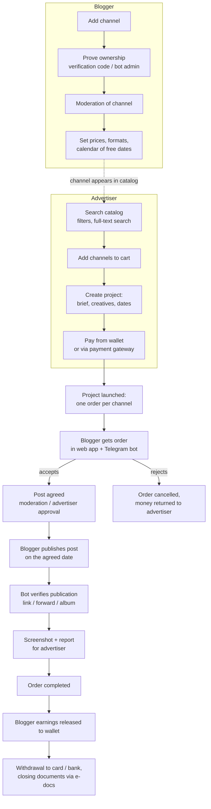

# Advertiser ↔ Blogger Marketplace: Backend

A backend for a marketplace where **advertisers** buy ad placements in **bloggers'** channels (mainly Telegram, with Instagram and YouTube support), and the platform handles everything in between: catalog, ordering, payments, publication control, documents and payouts.

> This repository is a **showcase**. The product is commercial and closed-source. Published here: the [Telegram bot source code](#telegram-bot-source-code) and the [Album Collector](#showcase-module-album-collector) module, which is extracted so it can run and be tested on its own. The sections below describe the whole system so the code can be seen in context. See [LICENSE](LICENSE).

---

## Table of contents

- [About the product](#about-the-product)
  - [Roles](#roles)
  - [Main flow](#main-flow)
  - [Order lifecycle](#order-lifecycle)
  - [Post verification in the Telegram bot](#post-verification-in-the-telegram-bot)
  - [Money flow](#money-flow)
  - [Other features](#other-features)
- [Architecture](#architecture)
  - [Runtime components](#runtime-components)
  - [Layers](#layers)
  - [Request flow](#request-flow)
  - [Tech stack](#tech-stack)
  - [Scale](#scale)
- [Telegram bot source code](#telegram-bot-source-code)
- [Showcase module: Album Collector](#showcase-module-album-collector)

---

## About the product

Buying ads from bloggers usually means manual work: finding channels, negotiating prices and dates in DMs, paying upfront with no guarantee, chasing the blogger to publish, and checking by hand that the post went out with the right text. The platform turns this into one managed process with escrow-style payments and automatic control of publication.

### Roles

| Role | What they do |
|------|--------------|
| **Advertiser** | Searches the channel catalog, builds a campaign (project), pays, approves posts, receives reports. |
| **Blogger** (channel owner) | Adds and verifies their channels, sets prices and available dates, accepts orders, publishes posts, gets paid. |
| **Agency / manager** | Runs campaigns on behalf of clients: builds projects, coordinates bloggers, gets aggregated reports. |
| **Moderator** | Approves channels and posts, handles complaints and disputes. |
| **Superuser** | Platform administration, finance operations, reference data. |

Users can act as a legal entity, an individual entrepreneur or an individual. Their legal data is validated against the national tax service.

### Main flow



### Order lifecycle

A **project** is the advertiser's campaign. When it is launched, it is split into **orders**: one order per channel. Each order has its own status, date, post and chat, so one blogger's delay never blocks the others.

The main path of an order, simplified:

```
 wait ──► in_progress ──► post_review / moderation ──► advertiser_coordination ──► completed
   │            │                    │                            │
   └────────────┴──── rejected / canceled (money is returned) ────┘
                         frozen (paused by the platform, can be resumed)
```

Every transition is a separate use case (`order_blogger_accept`, `order_blogger_reject`, `moderation_order_accept`, `advertiser_order_accept`, `publish_post`, ...). Each one changes the order, the paired project state and, where needed, the wallet in one place, so the state of money always follows the state of the order.

Reminders are sent to bloggers before the publication time, and late or missed publications are handled automatically.

### Post verification in the Telegram bot

This is the part of the system the published module belongs to.

1. After publishing, the blogger sends the post to the bot: a **link** (`t.me/channel/123`), a **forward** of the post, or the post as an **album**.
2. The bot extracts the channel and the post from the message (forward metadata or the URL).
3. The backend finds the blogger's orders for that channel for today.
4. The text of the published post is compared with the brief (fuzzy matching, so small formatting differences do not fail the check).
5. On a match, the publication is recorded, a screenshot is taken, and the advertiser sees the result in the report.

Albums need special handling because Telegram delivers them as several separate updates. That is what the [Album Collector](#showcase-module-album-collector) solves.

The bot also lets users create projects from Telegram, receive and accept orders, and get notifications.

### Money flow

- Every user has an internal **wallet**. Advertisers top it up through online payment gateways or by bank transfer with an invoice.
- When a project is paid, the money is **held** on the platform, not sent to the blogger right away.
- When an order is completed, the blogger's part is released to their wallet. When an order is cancelled or rejected, the advertiser gets the money back.
- Bloggers withdraw earnings to a card or bank account; withdrawals go through approval.
- Platform commission, VAT and promo code discounts are calculated in the domain layer and stored as separate lines, so every amount on an invoice can be traced.
- Contracts, invoices and acts are signed through an **electronic document** service, with status updates coming back by webhook.

### Other features

- **Catalog and search**: full-text channel search with filters, categories and channel statistics collected from social networks.
- **Channel calendar**: bloggers mark busy days and limits; the platform does not sell dates that are taken.
- **Chats**: real-time chats per order and per project between the advertiser, the blogger and support.
- **Notifications**: in-app (real-time), email and Telegram.
- **Promo codes** for carts and projects.
- **Reports**: PDF and Excel reports for advertisers and agencies, screenshots of published posts.
- **AI helpers**: generating post text and images for a brief.
- **Admin panel API**: moderation queues, order management, finance operations, bulk import of channels from spreadsheets.

---

## Architecture

### Runtime components

> This section shows the core backend. For all services of the system (CRM, report service, scheduler, userbots, tax adapter, deployment) see **[docs/SYSTEM_OVERVIEW.md](docs/SYSTEM_OVERVIEW.md)**.

```
                    ┌───────────────────────────── backend ──────────────────────────────┐
 Web app ──────────►│                                                                     │
 Admin panel ──────►│  FastAPI REST API  (/api/v1)                                        │
                    │                                                                     │
 Telegram ─webhook─►│  aiogram 3 bot  ──► AlbumCollectorMiddleware ──► handlers           │
 Payment / e-docs ─►│  webhook endpoints                                                  │
                    │            │                                                        │
                    │            ▼                                                        │
                    │  application layer: use cases with input / output DTOs             │
                    │            ▲                                                        │
                    │  FastStream worker (NATS): events, background jobs, reports        │
                    └──┬──────────┬──────────┬───────────┬───────────┬───────────────────┘
                       │          │          │           │           │
                 PostgreSQL     Redis    Manticore   Centrifugo   S3 storage
                 (write/read)  (cache,   (full-text  (real-time   (media, reports,
                               bot state, search)    chats and    screenshots)
                               locks)                notifications)
```

- **Web service.** FastAPI under gunicorn with several workers. The Telegram bot runs **in webhook mode inside the same app**, so bot updates are served by the same workers as HTTP requests.
- **Worker.** A separate process on FastStream + NATS. Use cases publish events (order changed, channel added, report requested...), and consumers grouped by domain (order, project, channel, chat, notification, report, search) handle them asynchronously. A transactional outbox keeps events consistent with database writes.
- **PostgreSQL** with separate write and read connections. Migrations with Alembic.
- **Redis** for cache, bot FSM state, and short-lived coordination data such as album buffers and locks.
- **Manticore Search** for catalog search, **Centrifugo** for real-time delivery, **S3** for files.

### Layers

The code follows **Clean Architecture** with a **CQRS-style split** of the application layer:

```
presentation   FastAPI routes, request/response models, bot handlers, middlewares
     │
application    use cases:  record/  (commands, change state)
     │                     read/    (queries, return read models)
     │                     events/  (event handlers)
     │         each use case = dto.py + interface.py + use_case.py
     │
domain         entities, value objects, domain services (wallet, order, organization ...)
     ▲
infrastructure SQLAlchemy models and repositories, payment gateways, e-docs, search,
               real-time, S3, email, social network clients, DI providers
```

Rules:
- the domain has no dependencies on frameworks;
- a use case depends only on interfaces (`Protocol`) that it declares itself, and returns DTOs, never ORM objects or domain entities;
- infrastructure implements those interfaces;
- everything is wired with **Dishka**, and the same use case is called from an HTTP route, a bot handler or a broker consumer.

### Request flow

1. A request reaches a FastAPI route (or a bot handler, or a broker consumer).
2. The input is validated by a Pydantic model and converted into the use case input DTO.
3. The use case is resolved from the DI container and called.
4. The use case applies business rules through domain services and talks to the outside world only through its interfaces.
5. Repositories run the SQL and return data.
6. The use case returns an output DTO, and the route turns it into the HTTP response.

### Tech stack

| Area | Technology |
|------|------------|
| Language | Python 3.10, asyncio |
| HTTP API | FastAPI, Pydantic, gunicorn / uvicorn |
| Telegram | aiogram 3 (webhook) |
| DI | Dishka |
| Database | PostgreSQL, SQLAlchemy 2.0 async, asyncpg, Alembic |
| Messaging | NATS, FastStream |
| Cache / coordination | Redis |
| Search | Manticore Search |
| Real-time | Centrifugo |
| Storage | S3-compatible object storage |
| Auth | JWT, Google OAuth2 |
| Integrations | payment gateways, electronic documents, tax service, email, social network APIs, OpenAI |
| Observability | structlog, Prometheus, Sentry |
| Delivery | Docker, GitHub Actions, Kubernetes |
| Tests | pytest, pytest-asyncio, fakeredis |

### Scale

About **100,000 lines** of application code in ~1,800 files: several hundred use cases, ~50 database migrations, dozens of HTTP routers, and three deployable processes (web, worker, bot) built from one codebase.

---

## Telegram bot source code

The Telegram bot of the platform, as it is in the main repository: about 16,000 lines of code and 7,000 lines of tests. The paths are kept the same as in the project, so the layers are visible.

```
bot.py                                       # local polling entry point (production runs via webhook in the API)
advertiser_blogger/
├── presentation/bot/                        # aiogram layer
│   ├── handlers/                            # user, channel, group and agency handlers
│   ├── filters/  keyboards/  states/        # routing filters, inline keyboards, FSM states
│   ├── album/                               # Album Collector (media group buffering)
│   ├── message_batch/                       # batching of several messages into one submission
│   └── common/                              # parsing of forwards, links and post submissions, texts
├── application/interactors_bot/             # bot use cases
│   ├── verify_and_publish_post/             # check a published post against the brief
│   ├── verify_submission_processor/         # one entry point for link / forward / album submissions
│   ├── run_post_checking/                   # batch check of published posts for selected projects
│   ├── match_and_attach_post/               # find the order a post belongs to by text similarity
│   ├── project_create/                      # creating an ad project from Telegram
│   ├── publish_post_broadcast/              # record the publication, events and notifications
│   └── ...
└── infrastructure/bot/                      # bot instance, deep links, HTML → Telegram formatting, templates
tests/unit/presentation/bot/                 # handler, parser and collector tests
tests/unit/application/interactors_bot/     # use case tests
```

Handlers contain no business logic: they parse the update, build an input DTO and call a use case resolved from the Dishka container. The same use cases and domain services are used by the HTTP API.

> This code imports the domain, the main application layer and the DI setup of the closed-source project, so it is published **for reading** and does not run on its own. The runnable and tested part is the Album Collector below.

---

## Showcase module: Album Collector

An [aiogram 3](https://docs.aiogram.dev/) middleware that turns a Telegram **media group** (an album of several photos / videos / documents) into **one** event, safely, across multiple backend workers. It is used in the [post verification](#post-verification-in-the-telegram-bot) flow.

Telegram delivers an album as several separate updates, possibly to different workers, with the caption on only one of them. The collector buffers the parts in Redis (atomic append via Lua), waits for a quiet period, and hands the complete album to a single callback exactly once, protected by a distributed lock and an idempotency marker.

**Full explanation of the bot and the module: [docs/ALBUM_COLLECTOR.md](docs/ALBUM_COLLECTOR.md)**

Quick start:

```bash
pip install -r requirements-dev.txt
pytest
```

```
album_collector/
├── middleware.py         # aiogram outer middleware
├── collector.py          # debounce, flush, Message -> AlbumPart
├── models.py             # AlbumPart, AggregatedAlbum, RegisterResult
├── redis_store.py        # AlbumBufferStore protocol + Redis implementation (Lua)
├── memory_store.py       # in-memory implementation for tests
├── forward_message.py    # forward source extraction, post URL building
├── post_submission.py    # AggregatedAlbum -> PostSubmissionInput
├── telegram_post_url.py  # t.me post URL matching
└── config.py             # AlbumCollectorConfig
tests/                    # 18 tests, Redis emulated with fakeredis[lua]
docs/ALBUM_COLLECTOR.md   # detailed description
```
