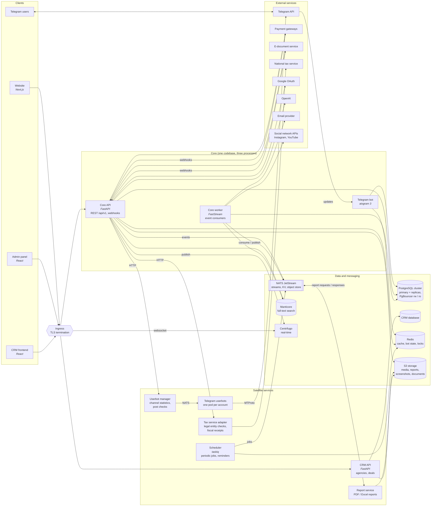
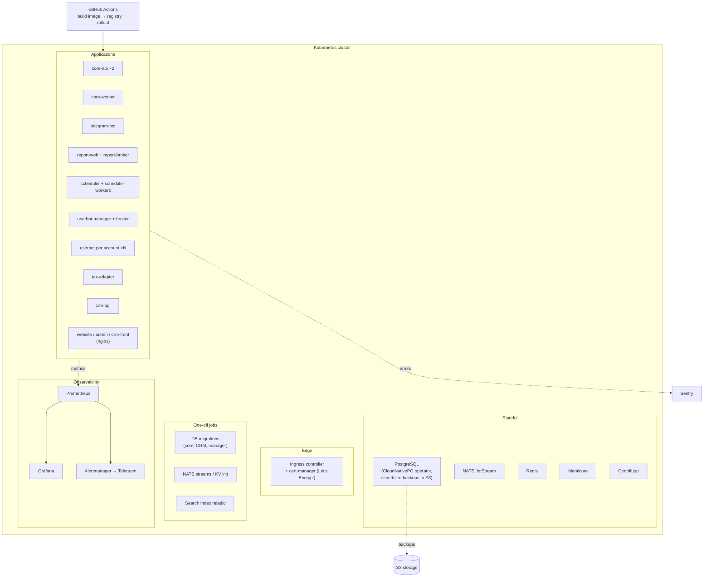

# System Overview

The main services of the marketplace and how they talk to each other.

Back to the project overview: [README](../README.md).

---

## Component diagram

## Services

| Service | Role | Talks to |
|---------|------|----------|
| **Core API** | The main backend: auth, catalog, carts, projects, orders, wallet, chats, admin API. Receives webhooks from payment and e-document services. | PostgreSQL, Redis, Manticore, S3, Centrifugo, NATS, satellites over HTTP |
| **Telegram bot** | Order notifications for bloggers, accepting orders, project creation from Telegram, submission and verification of published posts. Calls the same use cases as the API. | Telegram API, PostgreSQL, Redis |
| **Core worker** | Consumes domain events from NATS: order and project changes, notifications, search index updates, channel sync, chats. | NATS, PostgreSQL, Manticore, email, social networks |
| **Report service** | Builds PDF / Excel reports on request over NATS and returns the result. Heavy rendering is kept out of the API process. | NATS, S3 |
| **Scheduler** | Periodic jobs: publication reminders, deadlines, recurring sync. A taskiq scheduler plus a pool of workers. | NATS, Redis |
| **Userbot manager** | Manages Telegram user accounts that read channel statistics and check posts where the Bot API is not enough. Each account runs in its own pod. | Core API (HTTP), NATS, Telegram (MTProto) |
| **Tax service adapter** | Isolated integration with the national tax system: legal entity validation, fiscal data. Runs separately because it needs its own certificates. | Core API (HTTP), tax service |
| **CRM** | A separate product for advertising agencies: clients, deals, documents. Has its own database. Planned to use the marketplace as the executor of placements. | its own PostgreSQL, S3 |
| **Website / Admin panel / CRM frontend** | Single-page clients. | APIs through the ingress |

## Communication styles

| Style | Used for | Why |
|-------|----------|-----|
| **HTTP (sync)** | client → API, API → userbot manager, API → tax adapter, external webhooks | the caller needs the answer right now |
| **NATS events (async)** | API → worker, worker → worker | side effects that must not slow down or fail the user request |
| **NATS request / reply** | API ↔ report service | long-running jobs with a result |
| **Transactional outbox** | API → NATS | an event is published only if the database transaction committed |
| **Centrifugo** | API → browser | real-time chats and notifications without polling |

## Deployment

- Every service is a Docker image deployed by GitHub Actions.
- Database migrations and NATS / search initialization run as Kubernetes Jobs before a rollout.
- PostgreSQL runs under an operator with replicas, a read-write and a read-only connection pooler, and scheduled backups to object storage.
- Alerts from Prometheus go to a Telegram chat.
