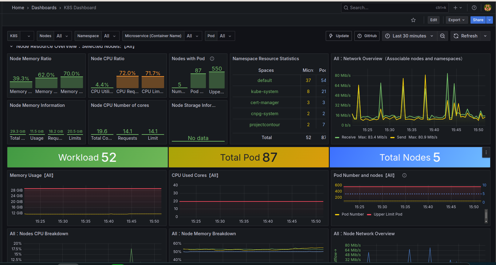
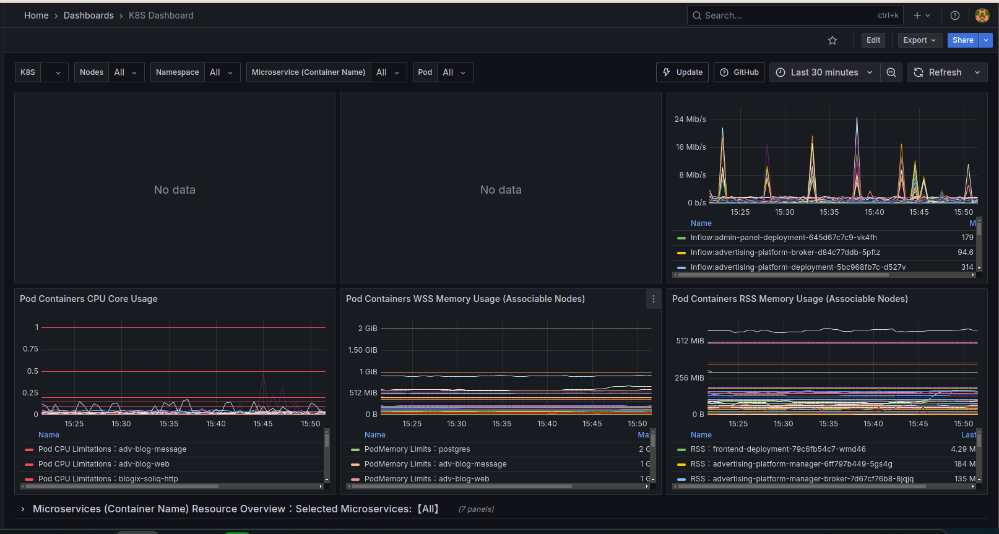
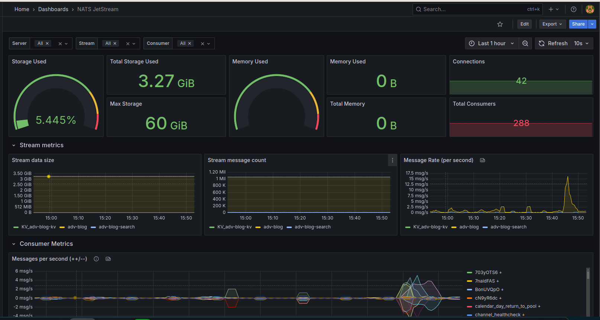
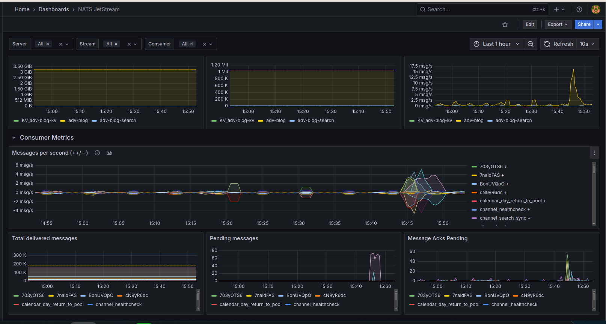
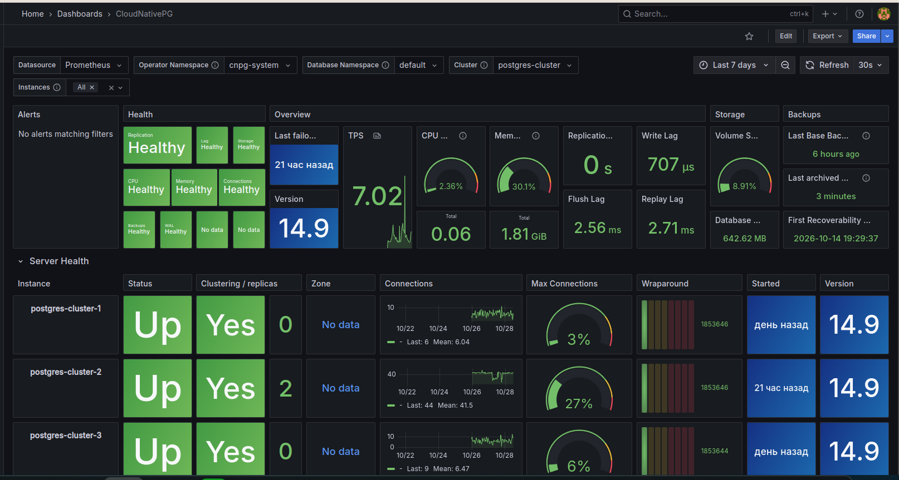
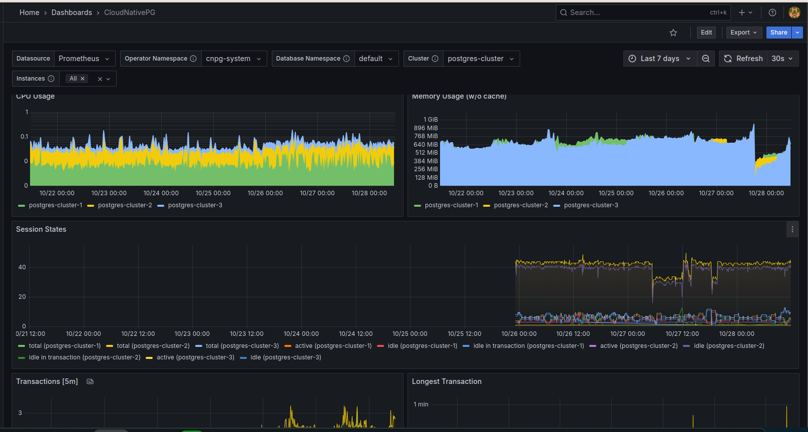
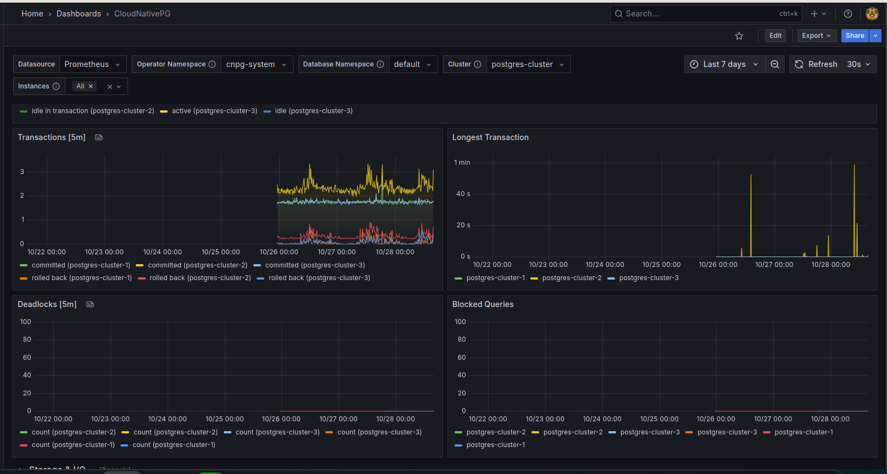
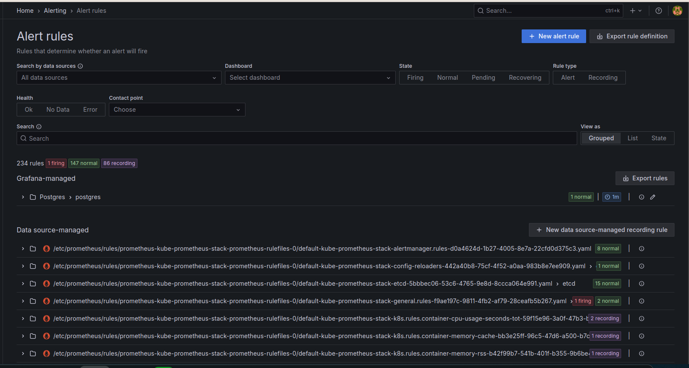
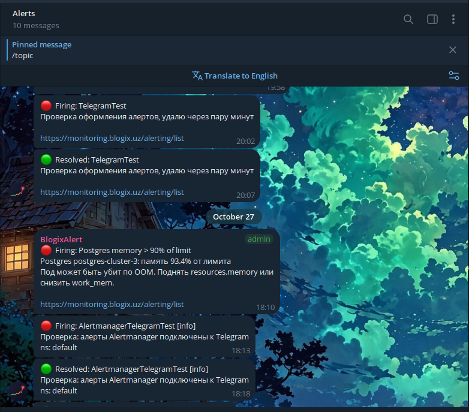

# Monitoring

How the production system is observed: cluster resources, the message broker, the database, and alerts that reach the team in Telegram.

Back to the project overview: [README](../README.md) · System diagram: [SYSTEM_OVERVIEW.md](SYSTEM_OVERVIEW.md)

> Screenshots are taken from the production Grafana.

---

## Table of contents

- [Stack](#stack)
- [Kubernetes cluster](#kubernetes-cluster)
- [NATS JetStream](#nats-jetstream)
- [PostgreSQL (CloudNativePG)](#postgresql-cloudnativepg)
- [Alerting](#alerting)
- [Alerts in Telegram](#alerts-in-telegram)

---

## Stack

```
 services (/metrics) ─┐
 node-exporter ───────┤
 kube-state-metrics ──┼──► Prometheus ──► Grafana (dashboards, Grafana-managed alerts) ─┐
 nats-exporter ───────┤        │                                                         ├──► Telegram group
 CloudNativePG ───────┘        └──► Alertmanager (kube-prometheus-stack rules) ──────────┘
```

| Part | Role |
|------|------|
| **Prometheus** (kube-prometheus-stack) | collects metrics from the cluster, the services, NATS and PostgreSQL |
| **Grafana** | dashboards and Grafana-managed alert rules |
| **Alertmanager** | routes alerts from the Prometheus rules |
| **Telegram group** | one place where the team gets every alert, with a link back to Grafana |
| **Sentry** | application errors with stack traces (not shown here) |

---

## Kubernetes cluster



The overview of the whole cluster:

- **5 nodes, 52 workloads, 87 pods** across namespaces `default` (applications), `kube-system`, `cert-manager`, `cnpg-system` (database operator) and `projectcontour` (ingress).
- Memory and CPU of the nodes: real usage next to the sum of requests and limits. It shows at once whether the cluster is over-committed. Here CPU usage is about 4% while requests are 72%, so the requests can be lowered before adding nodes.
- Pods per node against the node limit, and network traffic in and out.



Per-pod view for the application services: CPU of every container against its limit, WSS and RSS memory against the memory limit, and network traffic per pod. It helps to set resources for each service from real numbers and to catch a container that is close to an OOM kill.

---

## NATS JetStream

The broker carries domain events between the API and the workers ([communication styles](SYSTEM_OVERVIEW.md#communication-styles)).



- **Storage**: 3.27 GiB used out of 60 GiB.
- **42 connections, 288 consumers**.
- Three streams: `adv-blog` (domain events), `KV_adv-blog-kv` (key-value storage) and `adv-blog-search` (search index sync). For each one: data size, message count and message rate.



Consumer metrics, one line per consumer (for example `calendar_day_return_to_pool`, `channel_healthcheck`, `channel_search_sync`):

- messages delivered and acknowledged per second;
- **pending messages**: a consumer that falls behind is visible as a growing line;
- **acks pending**: messages taken by a worker but not confirmed yet, which usually points to a slow or stuck handler.

---

## PostgreSQL (CloudNativePG)

The database runs as a 3-instance cluster managed by the CloudNativePG operator.



- **Health** of replication, lag, storage, CPU, memory, connections, backups and WAL archiving at a glance.
- **Replication**: replication lag 0 s; write lag below 1 ms; flush and replay lag about 3 ms.
- **Backups**: the last base backup was 6 hours ago, WAL was archived 3 minutes ago, and point-in-time recovery is possible back to the first recoverability point.
- **Per instance**: status, role in the cluster, connections against `max_connections`, transaction ID wraparound, uptime and version.



CPU and memory of every instance over 7 days, and session states (`active`, `idle`, `idle in transaction`). A rise of `idle in transaction` usually means the application holds a transaction open while waiting for something external.



Committed and rolled back transactions, the longest running transaction, deadlocks and blocked queries. Long transactions and blocked queries are the first things to check when the API becomes slow.

---

## Alerting



**234 rules** in total:

- the standard **kube-prometheus-stack** rules for nodes, pods, etcd, Alertmanager and the Prometheus config;
- **86 recording rules** that precompute heavy queries, so dashboards stay fast;
- **Grafana-managed rules** written for the project, for example for PostgreSQL.

---

## Alerts in Telegram



Both Alertmanager and Grafana send alerts to one Telegram group:

- 🔴 **Firing** and 🟢 **Resolved** messages for every alert;
- the alert explains **what happened and what to do**. For example, *"Postgres memory > 90% of limit: postgres-cluster-3 uses 93.4% of the limit. The pod may be OOM-killed. Raise resources.memory or lower work_mem."*;
- every message links to the alert list in Grafana;
- the delivery path is tested with dedicated test alerts (`TelegramTest`, `AlertmanagerTelegramTest`).
